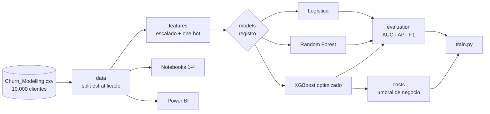

<p align="center"></p>

<h1 align="center">FinanceGuard</h1>

<p align="center"><b>Models and business scenarios to anticipate bank-customer churn.</b></p>

<p align="center"></p>

<p align="center">
     
</p>

<p align="center"><a href="https://dodysalim.github.io/"><b>🌐 Portfolio</b></a> · <a href="README.md"><b>🇪🇸 Versión en español</b></a></p>

---

## 📌 At a glance

| | |
| --- | --- |
| **🎯 Problem** | Compare churn models and pick a decision threshold that balances false positives and retention cost. |
| **🛠️ Solution** | Reusable `financeguard` package: data, features, model registry, evaluation and cost matrix. |
| **📈 Deliverables** | 4 notebooks, `train.py` CLI and a 3-page Power BI dashboard. |
| **💰 Business result** | Cost-based threshold (0.10) raises test-set net benefit from $58.4K to $111.7K under the stated cost assumptions. |
| **🗂️ Data** | Churn_Modelling: 10,000 customers. |

## 🏗️ Architecture



## 🚀 How to run

```bash
pip install -r requirements.txt
python train.py
pip install pytest nbclient ipykernel && python -m pytest tests -q
```

## ⚖️ Scope

Retention ROI figures are scenarios under assumptions, not recovered revenue.

---

<p align="center">
<b>Dody Dueñas Remache</b> · Data Analyst / Data Scientist · Guayaquil, Ecuador (remote LATAM)<br>
<a href="https://dodysalim.github.io/">Portfolio</a> · <a href="https://github.com/dodysalim">GitHub</a> · <a href="https://www.linkedin.com/in/dody-duenas/">LinkedIn</a> · <a href="mailto:dodydurema67@gmail.com">dodydurema67@gmail.com</a>
</p>
