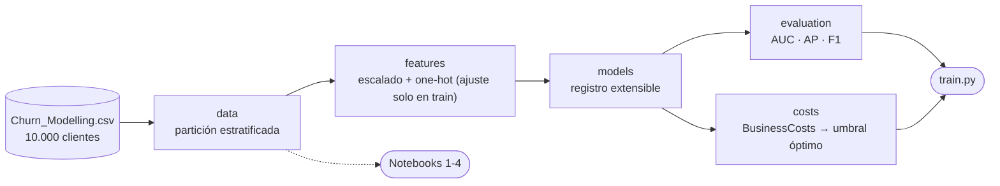

<p align="center"></p>

<h1 align="center">FinanceGuard</h1>

<p align="center"><b>Modelos y escenarios económicos para anticipar el abandono de clientes bancarios.</b></p>

<p align="center">

</p>

<p align="center">
     
</p>

<p align="center">
<a href="https://github.com/dodysalim/churn-prediction-financeguard/actions"></a>  
</p>

<p align="center"><a href="https://dodysalim.github.io/"><b>🌐 Portafolio</b></a> · <a href="docs/PORTFOLIO_CASE.md"><b>📄 Caso de estudio</b></a> · <a href="docs/VALIDATION.md"><b>✅ Verificación</b></a> · <a href="README.en.md"><b>🇺🇸 English</b></a></p>

---

## 📌 Resumen en 30 segundos

| | |
| --- | --- |
| **🎯 Problema** | Comparar modelos de churn bancario y elegir un umbral que equilibre falsos positivos y costos de retención. |
| **🛠️ Solución** | EDA, regresión logística, boosting y stacking; PCA y clustering para segmentar clientes. |
| **📈 Entregables** | Matriz de costos, escenarios de retención y dashboard Power BI de 3 páginas. |
| **🗂️ Datos** | Dataset Churn_Modelling: 10.000 clientes. |
| **👤 Autor** | Dody Dueñas Remache. |

## ❓ La pregunta de negocio

¿Cómo comparar modelos de churn y seleccionar un umbral considerando falsos positivos y costos de retención?

## ✨ Qué incluye

- EDA y regresión logística; comparación de boosting y stacking.
- PCA, clustering y análisis de segmentos.
- Matriz de costos y escenarios de retención; tres páginas Power BI.

## 🚀 Cómo ejecutarlo

Usa Python 3.11 o 3.12 en un entorno independiente. Desde la raíz:

```bash
python -m venv .venv
# Windows: .venv\Scripts\activate
# macOS/Linux: source .venv/bin/activate
python -m pip install -r requirements.txt
```

Después de configurar los datos:

```bash
python -m jupyter lab
```

## ⚙️ Uso como paquete

La lógica de los notebooks está disponible como paquete reutilizable en `src/financeguard/` (datos, features, modelos, evaluación y costos):

```bash
python train.py                          # comparación de modelos + umbral de negocio
python train.py --models logistic xgboost
```

```python
from financeguard import costs, data, features, models
split = data.stratified_split(data.load_dataset())
X_train, X_test, _ = features.fit_transform(split.X_train, split.X_test)
model = models.build('xgboost_optimized', models.class_ratio(split.y_train)).fit(X_train, split.y_train)
```

## 🗂️ Datos y configuración

Dataset Churn_Modelling incluido, con 10.000 registros. Abre los notebooks desde la carpeta notebooks y sigue el orden numerado.

## 📊 Power BI · PC y móvil

[Archivos e instrucciones](powerbi/README.md). Descarga el repositorio completo y abre `powerbi/Abrir-PowerBI.bat` en Windows; después pulsa **Actualizar**. Incluye A4 horizontal a tamaño real (100 %) y diseño móvil vertical. El archivo `.pbip` necesita sus carpetas Report, SemanticModel y data.

## 🏗️ Arquitectura



## 🧭 Estructura del repositorio

| Ruta | Qué contiene |
| --- | --- |
| [notebooks/](notebooks/) | EDA, modelos, segmentación y costos |
| [src/financeguard/](src/financeguard/) | Paquete reutilizable: datos, features, registro de modelos, evaluación y costos |
| [train.py](train.py) | Entrenamiento y umbral de negocio desde la terminal |
| [data/Churn_Modelling.csv](data/Churn_Modelling.csv) | Datos académicos originales |
| [images/](images/) | Figuras publicadas |
| [tests/](tests/) | Pruebas de datos y notebooks |

## ✅ Calidad y alcance

Los 4 notebooks se ejecutan completos sin errores (verificado el 26-10-2026 con las versiones de `requirements.txt`). Las pruebas automáticas comprueban el dataset y ejecutan los notebooks 1 y 4 en cada cambio:

```bash
python -m pip install pytest nbclient ipykernel
python -m pytest tests -q
```

La retención y el ROI son escenarios con supuestos, no ingresos recuperados observados. El dashboard Power BI analiza Exited observado, no probabilidades nuevas del modelo.

## 👥 Autoría

Proyecto integrador del módulo 4 de Henry, localizado en la carpeta M4. Dody Salim Dueñas Remache.

[Documentación anterior](docs/ORIGINAL_README.md), conservada como referencia histórica.

---

<p align="center">
<b>Dody Dueñas Remache</b> · Analista de Datos / Data Scientist<br>
<a href="https://dodysalim.github.io/">Portafolio</a> · <a href="https://github.com/dodysalim">GitHub</a> · <a href="https://www.linkedin.com/in/dody-duenas/">LinkedIn</a> · <a href="mailto:dodydurema67@gmail.com">dodydurema67@gmail.com</a>
</p>
